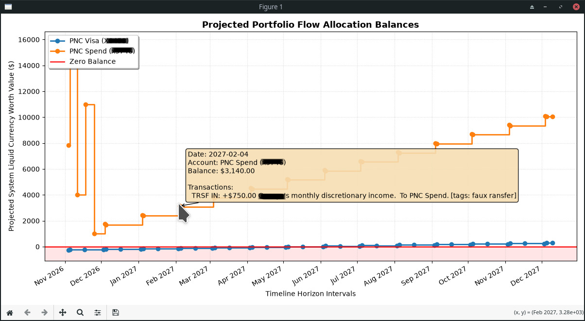

* HomeBank Cash Flow Forecast

This script parses your native HomeBank (=*.xhb=) transaction file and projects future account balances using:

- Your manually entered starting balance and as-of date
- Past recurring templates (=<fav>=) and actual transactions (=<ope>=) from the XML
- A daily ledger simulation that prints each change and draws a chart

It was written because HomeBank is great at tracking history, but I wanted better forecasting for "what will my balances look like in 90 days?"

#+CAPTION: Projected balances
#+ATTR_HTML: :width 600px

** Installation

1. Save the script as =forecast.py=.
2. Make it executable (Linux/macOS):
   #+begin_src sh
   chmod +x forecast.py
   #+end_src
3. Install dependencies:
   #+begin_src sh
   # Debian/Ubuntu
   sudo apt install python3 python3-matplotlib

   # macOS with Homebrew
   brew install python matplotlib
   #+end_src

** Configuration

Run the script against a *copy* of your HomeBank file (safety first, even though the script only reads it):

#+begin_src sh
./forecast.py copy-of-my-finances.xhb
#+end_src

On first launch, the configuration wizard asks:

- Which accounts to track (type =y=/=n=)
- The *current starting balance* for each tracked account
- The *as-of date* for that balance (=YYYY-MM-DD=)
- How many days to project into the future (default 90)

The answers are saved to =forecast_config.json=. Subsequent runs are completely headless.

*** Set balances as of a specific date

If your statement balance is from January 31, enter that as the as-of date. Any transactions dated *before* that date are automatically ignored, preventing double-counting and ledger drift.

** Usage

Basic forecast:

#+begin_src sh
./forecast.py finances.xhb
#+end_src

Filter to only accounts whose names match a pattern (=PNC=, =Chase=, etc.):

#+begin_src sh
./forecast.py finances.xhb --filter PNC Chase
#+end_src

Specify an absolute date range:

#+begin_src sh
./forecast.py finances.xhb --start 2026-11-01 --end 2027-01-30
#+end_src

Specify a rolling horizon:

#+begin_src sh
./forecast.py finances.xhb --days 60
#+end_src

Redo the configuration wizard:

#+begin_src sh
./forecast.py finances.xhb --reconfigure
#+end_src

Show only month-end points on the chart instead of every balance change:

#+begin_src sh
./forecast.py finances.xhb --month-end
#+end_src

Run =./forecast.py -h= for all options.

** Expected Results

1. A console ledger showing each future transaction:

#+begin_example
==============================================================================================================
FORECAST TIMELINE (2026-11-05 to 2027-12-10)
==============================================================================================================
Date        | Account                        | Change       | Proj Balance   | Description / Tags
==============================================================================================================
2026-12-03 | PNC Visa (xxxxx)               | -9.95        | $-241.95       | HURRICANE ELECTRIC LLC 510-58041 00 CA   [tags: recurring]
--------------------------------------------------------------------------------------------------------------
2026-12-04 | PNC Spend (xxxxx)              | 750.00       | $1,750.00      | TRSF IN: monthly discretionary income.   [tags: faux transfer]
--------------------------------------------------------------------------------------------------------------
2026-12-05 | PNC Spend (xxxxx)              | -55.00       | $1,695.00      | TRSF OUT: ESTIMATE - PNC Visa payoff.  Once Actual [tags: transfer]
2026-12-05 | PNC Visa (xxxxx)               | 55.00        | $-186.95       | TRSF IN: ESTIMATE - PNC Visa payoff.  Once Actual [tags: transfer]
--------------------------------------------------------------------------------------------------------------
#+end_example

2. A matplotlib chart titled *Projected Portfolio Flow Allocation Balances*, plotting each tracked account's balance over time with clean monthly axis labels.

** How It Works

- Actual operations (=<ope>=) after your as-of date are integrated.
- Recurring templates (=<fav>=) are expanded into future instances using their rules (daily, weekly, monthly, yearly).
- All transactions are applied day-by-day, so dates with no activity do not clutter the plot.
- The chart marks every actual balance change; flat periods are hidden for readability.

** License

GPL-3.0-or-later. See the script header for details.

* Future/new features?
** TODO Align balance calculations perfectly with homebank
  The forecast_config.json file exists to force current/recent balance to "known good" this is a concession to the fact that it is not calculating/tracking homebank's own running balance calculation perfectly.  Given the focus mainly forecasting form now into the future, this is the easiest thing to do, but requires setting the "known good" balances.

